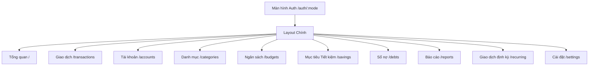

# Finora – Tài Liệu Đặc Tả Chi Tiết Hệ Thống (System Specification)

---

## 1. Tổng quan hệ thống

**Finora** là ứng dụng web quản lý tài chính cá nhân toàn diện, trực quan và hiện đại được xây dựng trên nền tảng **React 19, TypeScript, Vite, Tailwind CSS và Docker**.

- **Mục tiêu**: Cung cấp góc nhìn minh bạch về dòng tiền, tài sản ròng, ngân sách danh mục, kế hoạch tiết kiệm và sổ nợ.
- **Mô hình hoạt động**: Bản hiện tại vận hành hoàn toàn trên trình duyệt thông qua tầng dữ liệu client-side (`localStorage`), sẵn sàng chuyển đổi sang REST API backend thông qua lớp trừu tượng `src/services/financeService.ts`.
- **Điểm nổi bật**: Hỗ trợ chuẩn **WebMCP** (`document.modelContext`) cho phép AI Agent trực tiếp truy vấn số dư và tạo giao dịch thông minh.

---

## 2. Ngăn xếp công nghệ (Tech Stack)

| Thành phần | Công nghệ / Thư viện | Vai trò |
| :--- | :--- | :--- |
| **Giao diện & Nền tảng** | React 19 + TypeScript + Vite 7 | Xây dựng UI phản hồi nhanh, kiểm soát chặt chẽ kiểu dữ liệu |
| **Định tuyến (Routing)** | React Router v7 | Điều hướng SPA với các trang chuyên biệt và Layout chung |
| **Quản lý trạng thái** | Zustand v5 | Quản lý state tập trung cho toàn bộ dữ liệu tài chính |
| **Biểu đồ & Thống kê** | Recharts v3 | Vẽ biểu đồ Area, Bar, Line, Donut/Pie trực quan |
| **Kiểm thực & Form** | React Hook Form + Zod v4 | Xử lý form, validate schema giao dịch, tài khoản |
| **Giao diện & Biểu tượng** | Tailwind CSS + Lucide React | Hệ thống thiết kế tối giản, responsive, hỗ trợ Light/Dark theme |
| **Kiểm thử (Testing)** | Vitest | Kiểm thử tự động logic tính toán tiền tệ và số dư |
| **Đóng gói & Chạy ứng dụng** | Docker + Docker Compose + Nginx | Đóng gói production đa tầng (multi-stage build) và chạy độc lập |

---

## 3. Kiến trúc dữ liệu & Quy tắc nghiệp vụ cốt lõi

### 3.1. Các thực thể chính (Data Models)

1. **User**: Thông tin người dùng (`id`, `name`, `email`, `currency: 'VND'`, `financialMonthStart`: ngày bắt đầu tháng tài chính từ 1–28).
2. **Account**: Tài khoản tài chính (`id`, `name`, `type`: `bank` | `cash` | `ewallet` | `savings` | `investment`, `openingBalance`, `color`, `createdAt`, `active`).
3. **Category**: Danh mục thu/chi (`id`, `name`, `type`: `income` | `expense`, `icon`, `color`, `hidden`).
4. **Transaction**: Bản ghi dòng tiền (`id`, `name`, `amount`, `type`: `income` | `expense` | `transfer`, `categoryId`, `accountId`, `toAccountId`, `date`, `method`, `note`, `status`: `completed` | `pending`).
5. **Budget**: Ngân sách định mức tháng (`id`, `name`, `categoryId`, `limit`, `month: 'YYYY-MM'`).
6. **SavingsGoal**: Mục tiêu tích lũy (`id`, `name`, `target`, `startDate`, `dueDate`, `accountId`, `contributions: GoalContribution[]`).
7. **Debt**: Khoản vay/nợ (`id`, `name`, `kind`: `owed` (phải trả) | `lent` (cho vay), `principal`, `startDate`, `dueDate`, `interestRate`, `payments: DebtPayment[]`).
8. **RecurringTransaction**: Giao dịch lặp lại định kỳ (`id`, `name`, `amount`, `frequency`: `daily` | `weekly` | `monthly` | `yearly`, `nextDate`, `active`).

### 3.2. Quy tắc tiền tệ & Kế toán

- **Đơn vị tiền tệ**: Mọi số tiền lưu trữ dưới dạng **số nguyên VND** (`number`), không dùng số thập phân, tránh sai số float.
- **Tính toán số dư tức thời**: Số dư tài khoản = `openingBalance` + Tổng thu hoàn tất - Tổng chi hoàn tất + Tổng nhận chuyển khoản - Tổng gửi chuyển khoản.
- **Bảo toàn tổng tài sản khi chuyển khoản**: Giao dịch nội bộ (`transfer`) có tài khoản gửi và nhận; số dư 2 tài khoản đổi tương ứng nhưng **tổng thu nhập và chi tiêu chung không đổi**.
- **Đóng góp mục tiêu**: Đóng góp từ tài khoản khác sẽ sinh giao dịch chuyển khoản nội bộ sang tài khoản mục tiêu.
- **Thanh toán nợ**: Trả hoặc thu hồi nợ làm giảm dư nợ gốc và cập nhật tiền mặt/ngân hàng, không tính vào thu nhập hoặc chi tiêu tiêu dùng cá nhân.
- **Tài sản ròng (Net Worth)**: Tổng số dư tất cả tài khoản + Khoản cho vay còn lại - Khoản đang nợ người khác.

---

## 4. Chi tiết các trang & Chức năng hệ thống



### 4.1. Trang Xác thực tài khoản (`/auth/:mode`)
- **Đường dẫn**: `/auth/login`, `/auth/register`, `/auth/forgot`
- **Chức năng**:
  - Chuyển đổi linh hoạt giữa 3 chế độ: Đăng nhập, Đăng ký tài khoản và Quên mật khẩu.
  - Giao diện demo mô phỏng trải nghiệm đăng nhập mượt mà, chuyển tiếp trực tiếp vào ứng dụng chính.

### 4.2. Trang Tổng quan (`/`)
- **Đường dẫn**: `/` (Index Route)
- **Thành phần & Chức năng**:
  - **Bộ lọc thời gian**: Chọn nhanh Tuần này, Tháng này, 3 tháng, 6 tháng, Năm nay hoặc Tùy chỉnh ngày bắt đầu / kết thúc.
  - **Thẻ chỉ số tổng hợp (6 KPI Cards)**:
    1. *Tổng số dư*: Tổng tiền khả dụng kèm % tăng giảm so với kỳ trước.
    2. *Thu nhập*: Tổng tiền thu về trong kỳ đã chọn.
    3. *Chi tiêu*: Tổng tiền chi ra trong kỳ đã chọn.
    4. *Tài sản ròng*: Tổng số dư tài khoản cộng các khoản cho vay trừ đi nợ phải trả.
    5. *Đã dành cho mục tiêu*: Tổng tiền đã tích lũy vào các mục tiêu tiết kiệm.
    6. *Tỷ lệ tiết kiệm*: Phần trăm `(Thu nhập - Chi tiêu) / Thu nhập`.
  - **Biểu đồ Thu nhập & Chi tiêu (Area Chart)**: Trực quan hóa diễn biến thu/chi theo từng ngày hoặc tháng.
  - **Biểu đồ Tỷ trọng danh mục (Donut Chart)**: Thống kê cơ cấu các nhóm chi tiêu lớn nhất.
  - **Giao dịch gần đây**: Danh sách 5 giao dịch phát sinh mới nhất kèm nút bấm xem chi tiết.
  - **Tiến độ Ngân sách tháng này**: Thanh tiến trình thể hiện % hạn mức đã dùng, tự động đổi màu khi đạt ngưỡng 80% (vàng) hoặc vượt 100% (đỏ).
  - **Biểu đồ Dòng tiền từng tháng (Bar Chart)**: So sánh đối đầu giữa thu và chi của các tháng trong năm.
  - **Kế hoạch & Nhắc nhở**: Khối cảnh báo thông minh (khoản chi lớn nhất, ngân sách sắp chạm ngưỡng, mục tiêu tiết kiệm nổi bật, giao dịch định kỳ sắp tới).
  - **Tài sản ròng theo thời gian (Line Chart)**: Đường xu hướng giá trị tài sản ròng qua các mốc thời gian.

### 4.3. Quản lý Giao dịch (`/transactions`)
- **Đường dẫn**: `/transactions`
- **Chức năng**:
  - **CRUD Giao dịch**: Thêm mới, chỉnh sửa, xem chi tiết và xóa giao dịch.
  - **Bộ lọc đa tầng**: Tìm kiếm theo tên/ghi chú, lọc theo Loại (`Thu`, `Chi`, `Chuyển khoản`), theo Danh mục, theo Tài khoản, theo Khoảng ngày.
  - **Sắp xếp & Phân trang**: Sắp xếp Mới nhất, Cũ nhất, Số tiền cao nhất, Số tiền thấp nhất; phân trang 10 dòng/trang.
  - **Xuất dữ liệu**: Xuất danh sách giao dịch sau lọc ra file `finora-giao-dich.csv` (hỗ trợ UTF-8 BOM hiển thị chuẩn tiếng Việt trên Excel).

### 4.4. Quản lý Tài khoản (`/accounts`)
- **Đường dẫn**: `/accounts`
- **Chức năng**:
  - **Tổng hợp tài sản**: Xem tổng số dư của toàn bộ hệ thống tài khoản.
  - **Danh sách thẻ tài khoản**: Thẻ đại diện theo màu sắc cá nhân hóa, loại tài khoản (Ngân hàng, Tiền mặt, Ví điện tử, Tiết kiệm, Đầu tư).
  - **Chuyển tiền nội bộ**: Chuyển khoản giữa 2 tài khoản (kiểm tra tài khoản nhận khác tài khoản gửi, kiểm tra đủ số dư).
  - **Lịch sử biến động**: Xem danh sách giao dịch phát sinh gần nhất của riêng từng tài khoản.
  - **Bảo vệ toàn vẹn**: Chặn xóa tài khoản nếu tài khoản đó đã có giao dịch hoặc kế hoạch liên quan.

### 4.5. Quản lý Danh mục (`/categories`)
- **Đường dẫn**: `/categories`
- **Chức năng**:
  - Phân loại 2 nhóm: Danh mục Chi tiêu và Danh mục Thu nhập.
  - Thêm mới danh mục với màu sắc và tên tùy biến.
  - Ẩn/Hiện danh mục để tinh gọn menu khi nhập giao dịch mà không làm mất lịch sử các giao dịch cũ.

### 4.6. Quản lý Ngân sách (`/budgets`)
- **Đường dẫn**: `/budgets`
- **Chức năng**:
  - Thiết lập hạn mức chi tiêu cho từng danh mục theo từng tháng cụ thể (`YYYY-MM`).
  - Thanh tiến trình trực quan: Tính toán tự động số tiền thực chi từ các giao dịch trong tháng, cảnh báo khi chạm 80% hoặc vượt hạn mức (100%).

### 4.7. Mục tiêu Tiết kiệm (`/savings`)
- **Đường dẫn**: `/savings`
- **Chức năng**:
  - Khởi tạo mục tiêu tài chính: Tên mục tiêu, số tiền mục tiêu cần đạt, thời hạn hoàn thành, tài khoản lưu giữ.
  - Đóng góp vào mục tiêu: Ghi nhận số tiền nạp thêm vào quỹ tiết kiệm; tự động hạch toán chuyển khoản nếu tiền được trích từ tài khoản khác.
  - Theo dõi tiến độ tích lũy trực quan theo tỷ lệ phần trăm (%).

### 4.8. Sổ Nợ & Cho vay (`/debts`)
- **Đường dẫn**: `/debts`
- **Chức năng**:
  - Quản lý 2 luồng nợ độc lập:
    - **Nợ phải trả (Owed)**: Các khoản vay người khác, vay ngân hàng.
    - **Cho vay (Lent)**: Tiền cho người khác mượn cần thu hồi.
  - Ghi nhận thanh toán / thu hồi: Mỗi lần trả bớt nợ sẽ cập nhật số dư nợ còn lại và tạo dòng tiền tương ứng.
  - Cảnh báo thời hạn đến hạn trả nợ.

### 4.9. Báo cáo & Phân tích chuyên sâu (`/reports`)
- **Đường dẫn**: `/reports`
- **Chức năng**:
  - Tổng hợp cơ cấu thu/chi theo khoảng thời gian tùy chọn.
  - So sánh tỷ trọng từng nhóm danh mục theo thời gian.
  - Phân tích độ chênh lệch thu - chi và đề xuất mức dự phòng an toàn.
  - Xuất báo cáo thống kê chi tiết ra file CSV.

### 4.10. Giao dịch định kỳ (`/recurring`)
- **Đường dẫn**: `/recurring`
- **Chức năng**:
  - Lập lịch tự động cho các khoản tiền cố định: Tiền nhà, tiền lương, hóa đơn điện nước, phí dịch vụ hàng tháng.
  - Chu kỳ linh hoạt: Hàng ngày, hàng tuần, hàng tháng, hàng năm.
  - Nút bấm **"Ghi nhận kỳ này"**: Nhanh chóng tạo bản ghi giao dịch thực tế khi đến kỳ thanh toán và tự động tính ngày cho kỳ tiếp theo.
  - Tạm dừng hoặc kích hoạt lại lịch lặp.

### 4.11. Cài đặt hệ thống (`/settings`)
- **Đường dẫn**: `/settings`
- **Chức năng**:
  - Đổi tên hiển thị người dùng và email.
  - Cấu hình **Ngày bắt đầu tháng tài chính** (từ ngày 1 đến 28 hàng tháng, ví dụ ngày nhận lương ngày 5 hoặc 10).
  - Tùy chỉnh chế độ giao diện: Sáng (Light) / Tối (Dark).
  - **Khôi phục dữ liệu mẫu (Reset Data)**: Xóa sạch dữ liệu cục bộ và nạp lại bộ dữ liệu chuẩn ban đầu để trải nghiệm lại từ đầu.

---

## 5. Tích hợp AI / WebMCP API

Finora triển khai cơ chế **WebMCP Tool Registration** tại `src/lib/webmcp.ts`. Khi ứng dụng chạy trong môi trường browser có hỗ trợ `document.modelContext`, hệ thống tự động đăng ký:

1. `get_finance_summary`:
   - Schema: Không cần tham số đầu vào.
   - Kết quả: Trả về `{ income, expense, accountCount }` của các giao dịch hoàn tất.
2. `create_transaction`:
   - Schema: Nhận thông tin `{ name, amount, type, categoryId, accountId, date, note }`.
   - Kết quả: Tự sinh ID, thêm giao dịch vào state và cập nhật tức thì toàn bộ biểu đồ, số dư trên màn hình người dùng.

---

## 6. Hướng dẫn vận hành & Triển khai

### 6.1. Chạy trên môi trường Local Development
```bash
# Cài đặt thư viện
pnpm install

# Khởi chạy dev server (Port 5173)
pnpm dev

# Chạy kiểm thử tự động
pnpm test

# Build mã nguồn production
pnpm build
```

### 6.2. Chạy với Docker & Nginx
```bash
# Khởi chạy toàn bộ hệ thống bằng Docker Compose (Port 8080)
docker compose up -d --build

# Xem log hoạt động
docker compose logs -f

# Dừng hệ thống
docker compose down
```
Ứng dụng sẽ được phục vụ tại: **`http://localhost:8080`**.

